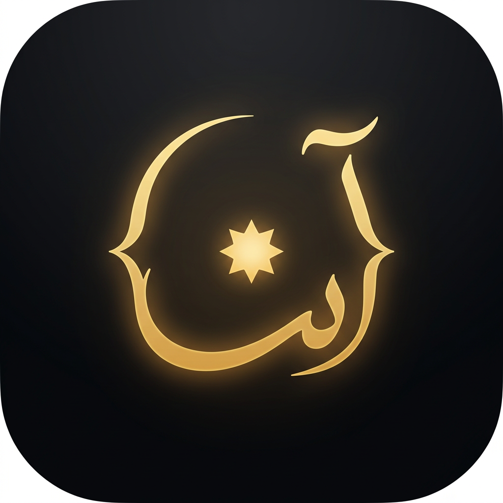
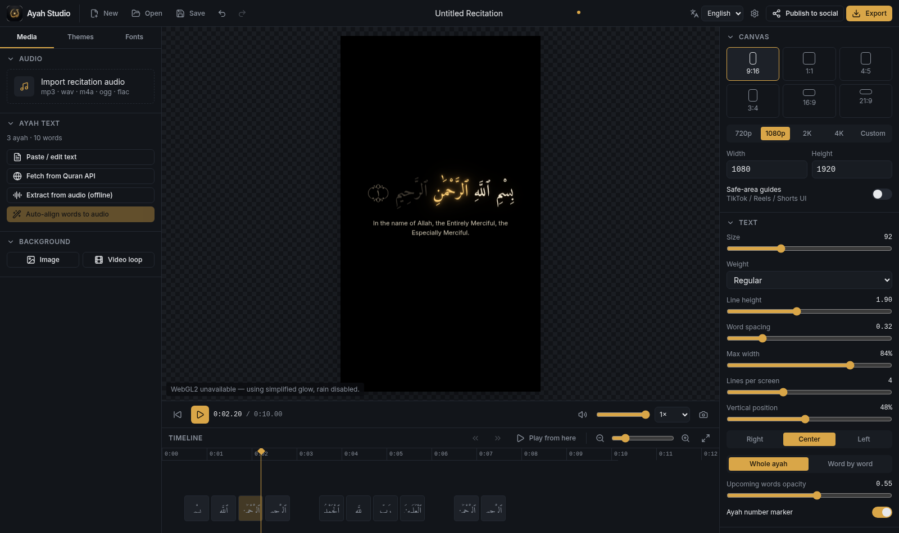

<div align="center">



# Ayah Studio

**Offline desktop studio for creating Quran recitation (tilawat) reels — and uploading them to TikTok, Instagram, Facebook and YouTube.**

Import a recitation, add the ayah text, and Ayah Studio syncs every word to the voice with an elegant Deep Glow, rain-on-glass effects and respectful animations, then exports frame-accurate MP4 up to 4K, ready to post as Reels, Shorts and TikToks.

[](https://github.com/fuwxt/ayah-studio/releases/latest)
[](https://github.com/fuwxt/ayah-studio/actions/workflows/release.yml)


[Download](#download) · [Features](#features) · [Upload to social media](#upload-your-tilawat-reels-to-tiktok-instagram-facebook-and-youtube) · [User guide](#user-guide) · [Build from source](#build-from-source)



</div>

---

## Upload your tilawat reels to TikTok, Instagram, Facebook and YouTube

Ayah Studio is made for **creating Quran recitation reels and posting them on social media**. Every video you make is exported in the exact format each platform expects:

| Platform | Where it appears | Recommended export |
| --- | --- | --- |
| **TikTok** | For You feed | 9:16 · 1080×1920 · 30 fps · MP4 H.264 |
| **Instagram** | Reels (and 4:5 feed posts) | 9:16 · 1080×1920 · 30 fps — or 4:5 · 1080×1350 |
| **Facebook** | Reels and Page videos | 9:16 · 1080×1920 · 30 fps |
| **YouTube** | Shorts (or 16:9 long-form) | 9:16 · 1080×1920 — or 16:9 up to 4K |

After export, click **Publish to social**:

1. Ayah Studio writes a ready-made caption with the surah/ayah reference, reciter and hashtags (`#Quran #Tilawat #QuranReels …`) that you can edit and copy in one click.
2. One button per platform opens its **official upload page** (TikTok Studio, Instagram, Facebook Reels, YouTube Studio).
3. Pick the video from your `Exports` folder, paste the caption and post.

Your accounts and passwords never pass through Ayah Studio — uploads happen on each platform's own site. Use the **All platforms** export preset to render 9:16, 1:1 and 16:9 versions in a single click.

> **اردو:** Ayah Studio سے بنائی گئی تلاوت کی ریلز براہِ راست **TikTok، Instagram، Facebook اور YouTube** پر اپلوڈ کی جاتی ہیں۔ ویڈیو ایکسپورٹ کریں، «Publish to social» پر کلک کریں، تیار کیپشن کاپی کریں اور ہر پلیٹ فارم کا آفیشل اپلوڈ صفحہ کھول کر پوسٹ کر دیں۔
>
> **Roman Urdu:** Is software se tilawat ki jo reels banai jati hain, woh TikTok, Instagram, Facebook aur YouTube par upload hoti hain. Video export karein, "Publish to social" dabayein, caption copy karein aur platform ka upload page khol kar post kar dein.

---

## Download

Get the latest version from the **[Releases page](https://github.com/fuwxt/ayah-studio/releases/latest)**.

| File | Use it when |
| --- | --- |
| `AyahStudio-Setup-<version>-x64.exe` | **Recommended for Windows 10/11.** Installer with Start-menu and desktop shortcuts. |
| `AyahStudio-Portable-<version>-x64.exe` | Single exe that runs without installing — handy on USB drives or locked-down PCs. |
| `AyahStudio-<version>-win-x64.zip` | Unzip anywhere and run `Ayah Studio.exe`. |
| `Ayah Studio-<version>.dmg` / `.AppImage` | macOS and Linux builds. |

FFmpeg is **bundled** in every build, so export works immediately and fully offline.

> **Windows SmartScreen:** the builds are not code-signed yet, so Windows may show "Windows protected your PC". Click **More info → Run anyway**. The full source is in this repository and every release is built by the public GitHub Actions workflow.

---

## Features

### Workflow
- **Import recitation audio:** mp3, wav, m4a, ogg, flac. Shows the waveform, with trim, fade in/out, mute, volume and 0.5×–1.5× preview speed.
- **Ayah text, three ways:**
  - paste or import a `.txt` (tashkeel and waqf marks preserved exactly, with an optional translation line per ayah);
  - **fetch online** by surah and ayah range from the Quran.com API, in Uthmani script, with optional translation and EveryAyah reciter audio;
  - **Extract from audio offline** using [whisper.cpp](https://github.com/ggml-org/whisper.cpp), with Arabic and word-level timestamps.
- **Auto-align:** offline forced alignment matches every word of your text to the recitation, using an energy/onset analysis that is diacritic-aware and weighted by word length.
- **Timeline editor:** waveform with draggable word blocks, start/end handles, 10 ms or 100 ms nudges, multi-select, zoom, and play-from-here.

### Visual engine (WebGL2 / GLSL)
- **Correct Arabic shaping:** ligatures, tashkeel and RTL through the browser's HarfBuzz shaper. Each word is drawn as one shaped unit, so diacritics never overlap or break.
- **Word-synced highlight:** the current word glows and changes colour, spoken words keep a "done" colour, and upcoming words use a "pending" colour. Display the whole ayah or reveal it word by word.
- **Deep Glow:** multi-pass HDR bloom (threshold → 6-level dual-filter blur pyramid → additive composite), with Threshold, Radius, Intensity, Exposure, Falloff, Tint, Chromatic and a glow-only preview.
- **Per-word colour overrides:** select any words and set the text colour and glow colour independently.
- **Rain on glass:** a procedural raindrop shader with density, size, speed, fog, refraction and tint. It can optionally refract the text too.
- **Respectful animation presets:** fade in, soft rise, blur-to-sharp, gentle scale pop, slow float, and glow pulse, each with easing, duration and intensity controls.
- **Backgrounds:** solid colour, gradient, image or looping video.
- **Live 60 fps preview**, with an automatic Canvas 2D fallback when WebGL2 isn't available.

### Canvas and export
- **Aspect ratios:** 9:16, 1:1, 4:5, 3:4, 16:9 and 21:9, plus fully custom pixel sizes. Layout reflows automatically, and optional **TikTok / Reels / Shorts safe-area guides** are available.
- **Resolutions:** 720p, 1080p, 2K and 4K (3840×2160 / 2160×3840).
- **Formats:** MP4 (H.264 / H.265), WebM (VP9), MOV (ProRes 422 HQ) and PNG sequence, at 24/30/60 fps with a quality slider.
- **Frame-accurate offline rendering:** every frame is rendered deterministically and piped to FFmpeg (never screen-recorded), then muxed with the audio. You can export **with or without audio**.
- **GPU encoding** with NVENC, QuickSync, AMF or VideoToolbox when available, falling back to CPU automatically.
- Progress bar, ETA and cancel. **Batch-export several ratios in one click**, and save a **PNG thumbnail**.

### Themes, fonts and language
- **Six built-in themes:** Burgundy + Cream, Cream + Dark Green, Black + Gold, Midnight + Cyan, Emerald + Cream, and Charcoal + Amber. Every colour has a picker, hex input and opacity, and you can **save, import and export themes as `.json`**.
- **Bundled open-licence Quran fonts:** Amiri, Amiri Quran, Scheherazade New, Noto Naskh Arabic, Noto Kufi Arabic, Lateef and Reem Kufi, each with a live Arabic preview.
- **Add Custom Font** (`.ttf` / `.otf` / `.woff` / `.woff2`): the font is copied into your Fonts folder and available instantly for Arabic or translation text.
- Separate styling for the Arabic and the translation: size, weight, line height, spacing, alignment and max width.
- **UI in English, اردو (Urdu) and العربية (Arabic)**, with full RTL layout.

### Projects
- On first launch the app creates `Documents/AyahStudio/` (the location can be changed in Settings):
  ```
  AyahStudio/
  ├── Projects/      each project = its own folder with project.json + assets
  ├── Audio/
  ├── Text/
  ├── Fonts/
  ├── Themes/
  ├── Backgrounds/
  ├── Exports/       your finished reels
  ├── Cache/         whisper engine + models, temp renders
  └── Settings/
  ```
- Save, open, **autosave** and recent projects. Asset paths are stored relative to the project, so you can move or share a project folder.
- **Undo/redo** across every edit.

### Respect for the sacred text
Ayah Studio **never alters or auto-corrects Quranic words** and preserves every diacritic exactly as provided. Text extracted by speech recognition is clearly marked as needing verification, and when you are online you can **verify it against the Quran.com text** word by word.

---

## User guide

1. **Import audio.** In the left panel, open **Media → Import recitation audio** and choose your recitation.
2. **Add the text.** Use **Paste / edit text** (one ayah per line, translation optional), **Fetch from Quran API**, or **Extract from audio (offline)**.
3. **Sync.** Click **Auto-align words to audio**, then refine on the timeline: drag blocks or their edges, or select words and press ← / → (hold Shift for 100 ms steps).
4. **Style.** Pick a theme under **Themes**, a font under **Fonts**, and tune Glow, Rain, Animation and Background in the right panel. To recolour specific words, click them in the preview, using Shift/Ctrl-click to select several.
5. **Choose a format.** Pick a ratio such as **9:16** for Reels, Shorts and TikTok, and turn on the safe-area guides to keep text clear of the platform's buttons.
6. **Export.** Press **Export** or Ctrl+E, choose a preset (**TikTok · Reels · Shorts** or **All platforms**), and start.
7. **Publish.** Open **Publish to social**, copy the caption, and upload to TikTok, Instagram, Facebook and YouTube.

### Keyboard shortcuts

| Keys | Action |
| --- | --- |
| `Space` | Play / pause |
| `←` / `→` | Nudge selected words by 10 ms (`Shift` for 100 ms), or seek 1 s when nothing is selected |
| `Ctrl+Z` / `Ctrl+Y` | Undo / redo |
| `Ctrl+S` | Save project |
| `Ctrl+E` | Export |
| `Shift`/`Ctrl` + click | Multi-select words |
| Double-click a word | Play from that word |
| `Esc` | Clear selection |

### Offline speech-to-text (whisper.cpp)

Open **Extract from audio (offline)**. The first time, Ayah Studio offers to download:

- **Engine:** the latest official `whisper.cpp` release for Windows or Linux, from [ggml-org/whisper.cpp](https://github.com/ggml-org/whisper.cpp/releases), into `Cache/whisper/engine/`.
- **Model:** pick a size from [Hugging Face](https://huggingface.co/ggerganov/whisper.cpp). Models are saved to `Cache/whisper/models/`.

| Model | Size | Notes |
| --- | --- | --- |
| `base` | 142 MB | Fast; good for a quick draft |
| `small` | 466 MB | Better accuracy for Arabic |
| `medium` | 1.5 GB | High accuracy, slower |
| `large-v3-turbo` | 1.6 GB | **Best for Quran recitation** |

After the one-time download everything runs offline. To install manually, place `whisper-cli(.exe)` in `AyahStudio/Cache/whisper/engine/` and a `ggml-*.bin` model in `AyahStudio/Cache/whisper/models/`. On macOS, run `brew install whisper-cpp` and copy `whisper-cli` into the engine folder.

---

## Build from source

**Requirements:** Node.js 20 or newer and npm.

```bash
git clone https://github.com/fuwxt/ayah-studio.git
cd ayah-studio
npm install

npm run dev:desktop   # run the desktop app with hot reload
npm run dev           # UI-only preview in the browser (desktop features disabled)
npm run typecheck
```

### Create installers

| Command | Output (in `release/<version>/`) |
| --- | --- |
| `npm run dist:win` | Windows NSIS installer + portable exe (run on Windows) |
| `npm run dist:win-portable` | Windows portable exe + zip (also works when cross-building from Linux) |
| `npm run dist:mac` | macOS `.dmg` |
| `npm run dist:linux` | Linux `.AppImage` |

Each `dist` script downloads a static FFmpeg build for the target platform into `resources/ffmpeg/` (`scripts/fetch-ffmpeg.mjs`) and bundles it with the app. To use your own FFmpeg instead, put `ffmpeg(.exe)` in that folder before building.

### Releasing

Push a version tag and GitHub Actions builds Windows, macOS and Linux natively and attaches every installer to the GitHub Release:

```bash
npm version 1.0.1
git push --follow-tags
```

---

## Architecture

```
electron/
  main.ts          app folders, projects, fonts, themes, FFmpeg export pipeline,
                   whisper.cpp engine/model management, GPU encoder detection
  preload.ts       typed, sandboxed IPC bridge (window.ayah)
src/
  engine/
    renderer.ts    WebGL2 compositor: background, text atlas, Deep Glow, rain, 2D fallback
    shaders.ts     GLSL: dual-filter bloom pyramid, composite, rain-on-glass
    layout.ts      Arabic line layout, word metrics, ratio-aware reflow
    audio.ts       Web Audio playback, waveform peaks, trim/fades/speed
    exporter.ts    deterministic frame loop → FFmpeg (video + audio mux)
  lib/
    alignment.ts   offline forced alignment (energy/onset, diacritic-aware)
    arabic.ts      tokenising that preserves tashkeel and waqf marks
    quran.ts       Quran.com / EveryAyah online fetch and verification
    store.ts       Zustand state with undo/redo history and autosave
    presets.ts     ratios, resolutions, themes, animation presets, platforms
    i18n.ts        English / Urdu / Arabic UI strings
  components/      editor UI: top bar, panels, preview, timeline, dialogs
scripts/           FFmpeg fetcher and Electron bundler
```

**Security:** context isolation, no Node.js in the renderer, and a minimal typed IPC surface. External links open in the system browser.

---

## Credits and licences

- Ayah Studio is released under the [MIT License](LICENSE).
- Fonts: Amiri, Amiri Quran, Scheherazade New, Noto Naskh/Kufi Arabic, Noto Nastaliq Urdu, Lateef and Reem Kufi, all under the [SIL Open Font License 1.1](https://openfontlicense.org).
- [FFmpeg](https://ffmpeg.org) (LGPL/GPL) static builds via [ffmpeg-static](https://github.com/eugeneware/ffmpeg-static).
- [whisper.cpp](https://github.com/ggml-org/whisper.cpp) (MIT) and OpenAI Whisper models (MIT).
- Quran text and translations from the [Quran.com API](https://quran.com); recitations from [EveryAyah](https://everyayah.com).

Please verify every ayah against an authentic mushaf before publishing. May this tool help spread the words of Allah with beauty and care.
